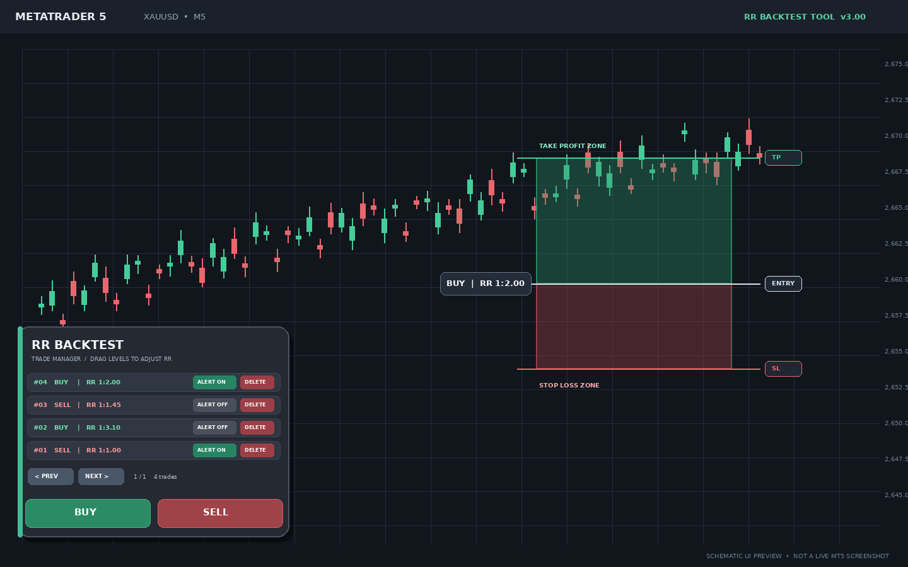

# RR Backtest Tool — MT5 v3.00

> تصویر بالا پیش‌نمایش شماتیک رابط کاربری است، نه اسکرین‌شات واقعی از اجرای MetaTrader 5.

ابزار رسم و بررسی **ریسک به ریوارد** برای بک‌تست دستی روی نمودار MetaTrader 5. با BUY یا SELL یک مجموعه باکس مستقل ایجاد کن، سطح ورود/استاپ/تی‌پی را با ماوس تنظیم کن و RR را روی نمودار ببین.

## امکانات نسخه 3.00

- دکمه‌های بزرگ **BUY** و **SELL** در پنل پایینِ سمت چپ.
- ایجاد باکس در مرکز محدوده‌ی قابل‌مشاهده‌ی چارت؛ مناسب برای کار روی کندل‌های تاریخی.
- مستطیل سبز برای محدوده‌ی سود و مستطیل قرمز برای محدوده‌ی ریسک؛ باکس‌ها با کشیدن قابل تنظیم و جابه‌جایی‌اند.
- نمایش `BUY | RR 1:x.xx` یا `SELL | RR 1:x.xx` در سمت چپ باکس؛ مقادیر پوینت/پیپ روی باکس نمایش داده نمی‌شوند.
- پنل تیره با فهرست معاملات، صفحه‌بندی، دکمه‌ی `ALERT ON/OFF` و `DELETE` برای هر ردیف.
- آلارم هر معامله مستقل است. پس از برخورد قیمت با SL یا TP، هشدار یک‌بار فعال می‌شود و دکمه به `ALERT HIT` تغییر می‌کند. خاموش و دوباره روشن کردن آلارم، آن را برای برخورد بعدی مسلح می‌کند.
- رنگ باکس‌ها به‌صورت بصری با شفافیت حدود ۶۰٪ ترکیب شده است؛ مستطیل استاندارد MT5 شفافیت آلفای واقعی برای Fill ندارد.
- هیچ نام یا کادر متنی برای استراتژی در رابط وجود ندارد.

## فاصله اولیه SL و TP

هنگام ساخت هر ابزار، فاصله هر دو سطح از قیمت ورود این‌طور محاسبه می‌شود:

`2 × میانگین (High − Low) بیست کندل بسته‌شده‌ی قبل از کندل مرجع`

کندل مرجع، کندل نزدیک به مرکز صفحه‌ی قابل‌مشاهده است؛ بنابراین در بک‌تست تاریخی، محاسبه بر اساس کندل‌های قبل از همان نقطه انجام می‌شود، نه الزاماً آخرین کندل بازار. با این پیش‌فرض، RR اولیه **1:1** است و با جابه‌جایی سطح‌ها تغییر می‌کند.

از ورودی‌های اندیکاتور می‌توان `InpAveragePeriod`، `InpCandleRangeMultiplier`، عرض باکس، شفافیت بصری و شناسه‌ی نمونه را تغییر داد.

## نصب

1. فایل ZIP را Extract کن.
2. در MT5 از **File → Open Data Folder** استفاده کن.
3. فایل `RR_Backtest_Tool.mq5` را در مسیر `MQL5/Indicators` کپی کن.
4. آن را در MetaEditor باز کن و **Compile** بزن.
5. در Navigator از مسیر **Indicators** اندیکاتور را روی چارت اجرا کن.

## استفاده

1. محدوده‌ی تاریخی مدنظرت را روی نمودار بیاور.
2. روی **BUY** یا **SELL** کلیک کن.
3. لبه‌های باکس سبز/قرمز را بکش تا Entry، TP و SL را تغییر بده؛ برای جابه‌جایی کل باکس، بدنه‌ی آن را بکش.
4. RR روی سمت چپ باکس و در فهرست پنل به‌روز می‌شود.
5. برای معامله‌ای که می‌خواهی پایش شود، `ALERT OFF` را بزن تا `ALERT ON` شود. `DELETE` همان معامله و باکس‌های آن را پاک می‌کند.

## نکته مهم درباره آلارم

آلارم‌ها با قیمت زنده‌ی نماد کار می‌کنند (برای BUY قیمت Bid و برای SELL قیمت Ask) و هنگام عبور قیمت از سطح ثبت‌شده هشدار می‌دهند. اندیکاتور استاندارد، حرکت تاریخی قیمت را به‌صورت تیک‌به‌تیک بازپخش نمی‌کند؛ بنابراین آلارم جایگزین شبیه‌ساز/Replay تاریخی نیست.

## سازگاری و بررسی

- نوع فایل: اندیکاتور MQL5 (`.mq5`)
- نسخه سورس: `3.00`
- سورس از نظر ساختار، نام توابع و توازن آکولادها بررسی شده است؛ با این حال در این محیط کامپایلر MetaEditor/MT5 در دسترس نبود. قبل از استفاده، در MetaEditor کامپایل و روی حساب دمو آزمایش کن.
